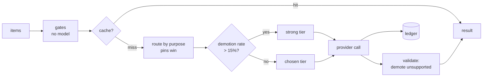

# Harness_Pipeline

A reusable harness for pipelines that call language models: **route every call by purpose,
log it, cache it by fingerprint, validate what comes back, escalate on evidence, and never
let a setting cost-optimize what a human reads.** Domain-agnostic by test. Extracted from a
pipeline that ran end to end for real (see `docs/case-study.md`).

```
pip install -e .            # library: harness_core
pytest -q                   # 142 offline tests; any real network/process call fails loudly
python examples/minimal_pipeline.py --run-dir /tmp/x     # whole pattern, fake provider, no model calls
cp -R template ../my-new-project && cd ../my-new-project && pip install -e . && pytest -q
```

## What it does, in one picture



## The mechanisms

| Mechanism | Module | One line |
|---|---|---|
| Purpose routing over pluggable providers | `router`, `providers` | `call_model(conn, prompt, purpose, policy)`; headless CLI, loopback Ollama, or OpenAI-compatible; key never logged |
| In-code pins | `router.pinned_tiers` | purposes a person reads stay on the strong tier no matter what the policy says |
| Composite-fingerprint cache | `cache` | key = ordered named hashes; change one input, invalidate exactly that |
| Usage ledger | `ledger` | measured provider usage and chars/4 estimates in separate columns, never summed |
| Agreement study | `evals`, `scripts/eval_routing.py` | a task moves to a cheaper tier only at >= 0.90 outcome agreement on real inputs; reference outputs reused |
| Demotion / escalation | `demotions` | per-provider fabrication rate; above 15% over the last 20 (n >= 5) escalates the next call |
| Workflow lock | `lock` | single writer; dead pid or 30 min = stale; SIGTERM releases |
| Failure classes + budget | `failures` | timeout / rate_limited / invalid_response / unavailable; budget decrements only on success |
| Stage runner + checkpoint | `runner`, `checkpoint` | `list -> list` stages persisted as JSONL; an 8-field block an agent resumes from |
| Offline guard | `guards`, `testing` | tests cannot spend or reach the network by accident |

## Layout

```
harness_core/        the library (no domain words; enforced by a test)
tests/               137 offline tests
template/            a complete starter project: router pins, cache fingerprints, cache-first
                     assess stage with demotion logging, run CLI under the lock, eval adapter,
                     tests, CLAUDE.md, CHECKPOINT.md, .claude/agents roles
examples/            minimal_pipeline.py: the whole pattern end to end with a fake provider
scripts/             eval_routing.py (generic agreement study), usage_report.py
docs/                architecture, cost-controls, eval-methodology, policy-schema, testing,
                     adopting, case-study
```

## Read next

- `docs/adopting.md` for the ten steps to a new project.
- `docs/cost-controls.md` for what each mechanism saved, with numbers.
- `CLAUDE.md` if you are an agent working in this repo.

## Honest limits

No programmatic subscription quota exists, so nothing here reports a quota percentage or a
charge as fact. The guard is a Python-level monkeypatch, not a sandbox. Prompt size, not call
count, is the remaining cost driver; retrieval of only the relevant context is not built.
