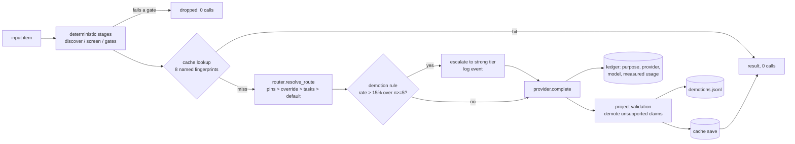

# Architecture

The harness is a library plus a pattern. The library (`harness_core`) has no opinion about
what a pipeline processes. The pattern (`template/`) is how a project wires the library so
that every model call is routed, logged, cached, validated, and gated.

## The path of one model call

## Module map

| Module | Owns | Never knows |
|---|---|---|
| `router` | purpose -> tier -> provider/model; `pinned_tiers`; `call_model` | what a purpose means |
| `providers` | `claude_cli` (headless CLI), `ollama` (loopback only), `openai_compatible` (key from env/.env, never logged) | routing |
| `ledger` | one row per call: purpose, provider, model, measured usage vs chars/4 estimate, kept separate | dollars as charges, quota percentages |
| `cache` | sha256 over an ORDERED dict of named components | what the components are |
| `policy` | YAML load + content hash; write-back preserving header comments | policy semantics |
| `evals` | two-tier agreement study, resumable, reference reuse, decide (0.90 / 0.75), apply to policy | what "agreement" means |
| `demotions` | per-provider claims/demoted log; escalate when rate > 0.15 over the last 20 with n >= 5 | what a demotion is |
| `lock` | single-writer JSON lock: pid liveness + 30-min staleness, SIGTERM release | the pipeline |
| `failures` | timeout / rate_limited / invalid_response / unavailable; `Budget` decrements only on success | retry policy |
| `gate`, `records` | `GateResult(name, passed, evidence)`, `UsageRecord`, `OpenStatusEvidence` | domain records |
| `evidence` | live uncached open/closed check by HTTP status + redirect chain | page text |
| `runner` | ordered `Stage(name, fn: list -> list)`, JSONL per stage | stage contents |
| `checkpoint` | the 8-field block: COMMAND/COMPLETED/PHASE/PILOT/USAGE/BLOCKER/NEXT/UPDATED | the project |
| `guards`, `testing` | offline guard (sockets, urllib, smtplib, httpx, subprocess.Popen); `isolate_default_paths` | project entry points (compose your own) |

## Where the project-specific rules live

| Rule | Where | Why in code and not in the policy file |
|---|---|---|
| Purposes pinned to the strong tier | `myproject/router.py::PINNED_STRONG` | a policy edit or an eval run must not be able to move them |
| Cache fingerprint set | `myproject/cache.py` | the key shape is a contract; append a defaulted component, never reorder |
| What a demotion is | `myproject/stages.py::_validate` | only the project knows what valid evidence looks like |
| CLI safety flags | `myproject/router.py::_RESTRICTED_FLAGS` | a narrow generation call gets no tools, no MCP servers |
| Live-call switch | `myproject/run.py::LIVE_SWITCH` | one switch for every provider, local ones included |
| Approval gates for irreversible actions | the project's state machine | never a prompt asking the model nicely |
